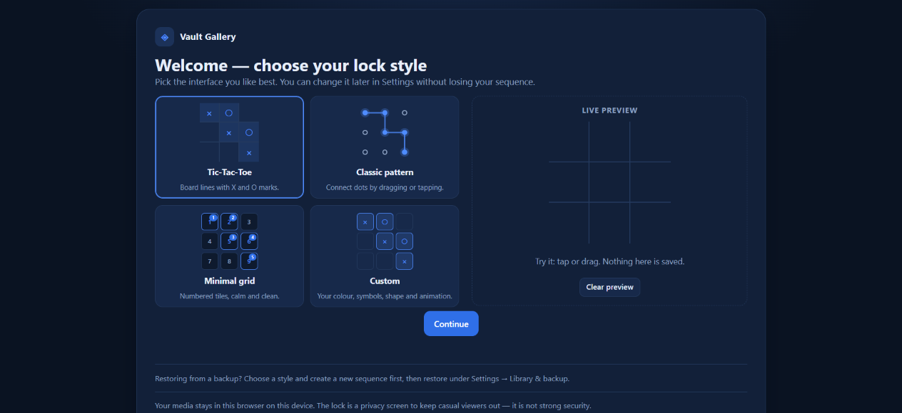
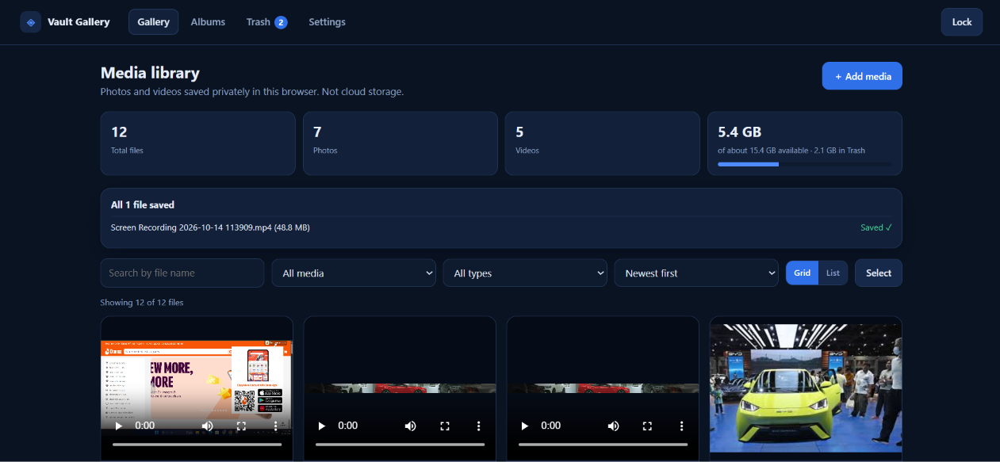
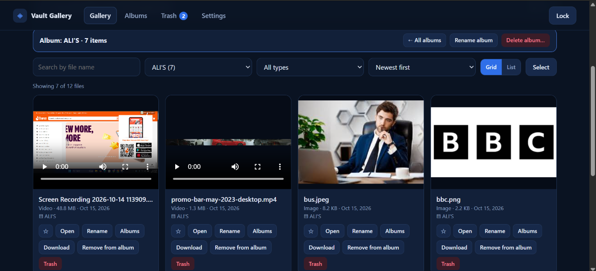
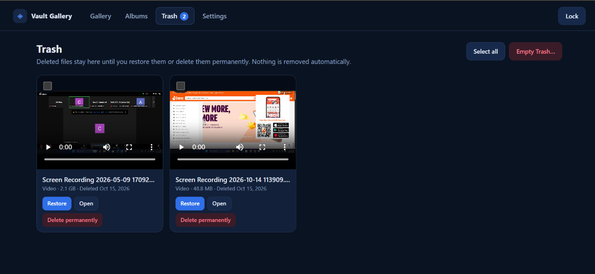
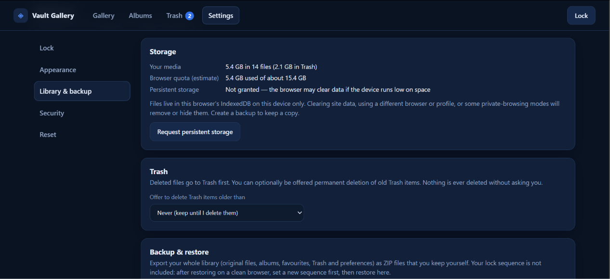

# Vault Gallery — Pattern-Lock Media Gallery

A browser-based image and video gallery featuring a pattern-lock interface, local media storage, albums, Trash recovery, and backup/restore functionality. Built with HTML, CSS, and JavaScript.

**Live Demo:** https://ALIRAZA123-AV-IS-available.github.io/vault-gallery/

**GitHub Repository:** https://github.com/ALIRAZA123-AV-IS-available/vault-gallery

## About the Project

Vault Gallery is a front-end web application designed to help users organize and manage personal images and videos directly in their browser. It combines a pattern-based lock screen with tools for searching, sorting, favouriting, grouping, and backing up media.

The application stores media locally in the browser rather than automatically uploading it to a server.

## Features

- **Pattern Lock:** Pattern-based setup and gallery access.
- **Lock Customization:** Supported pattern and grid styles.
- **Image and Video Gallery:** Upload and preview supported media files.
- **Search and Sorting:** Find and organize gallery items.
- **Favorites:** Mark important media for quick access.
- **Bulk Selection:** Select multiple items for supported actions.
- **Albums:** Create, rename, delete, and organize albums without duplicating media.
- **Trash and Recovery:** Restore deleted items or permanently remove them.
- **Media Management:** Preview, rename, and download files.
- **Themes:** Light and dark appearance options.
- **Auto-Lock:** Configure automatic locking options.
- **Local Media Storage:** Store media in IndexedDB and preferences in Local Storage.
- **Backup and Restore:** Export and restore library backups using ZIP files, with checksum and multipart backup support.
- **Storage Information:** View library and browser storage information.
- **Responsive Interface:** Designed for different screen sizes.

## Screenshots

Click any screenshot to open the full-size image.

### 1. Pattern Lock

[**Open Pattern Lock Screenshot**](https://github.com/ALIRAZA123-AV-IS-available/vault-gallery/blob/main/pattern-lock.png)

### 2. Media Gallery — View 1

[**Open Media Gallery Screenshot 1**](https://github.com/ALIRAZA123-AV-IS-available/vault-gallery/blob/main/media-gallery.png)

### 3. Media Gallery — View 2

[**Open Media Gallery Screenshot 2**](https://github.com/ALIRAZA123-AV-IS-available/vault-gallery/blob/main/media-gallery%281%29.png)

### 4. Albums

[**Open Albums Screenshot**](https://github.com/ALIRAZA123-AV-IS-available/vault-gallery/blob/main/albums.png)

### 5. Trash and Recovery

[**Open Trash Screenshot**](https://github.com/ALIRAZA123-AV-IS-available/vault-gallery/blob/main/trash.png)

### 6. Settings and Backup

[**Open Settings and Backup Screenshot**](https://github.com/ALIRAZA123-AV-IS-available/vault-gallery/blob/main/settings-and-backup.png)

## Technologies Used

- HTML5
- CSS3
- Vanilla JavaScript
- IndexedDB
- Local Storage
- Browser File APIs
- ZIP-based backup and restore
- GitHub Pages

## Getting Started

1. Open the [Live Demo](https://ALIRAZA123-AV-IS-available.github.io/vault-gallery/).
2. Download or clone the project from the [GitHub Repository](https://github.com/ALIRAZA123-AV-IS-available/vault-gallery).
3. Open `index.html` in a modern browser.
4. Complete the initial setup and create a pattern.
5. Unlock the gallery.
6. Upload supported images and videos.
7. Organize your media using search, favorites, albums, and other gallery features.

For best compatibility, run the application through HTTPS or `http://localhost`.

## Storage and Privacy

Vault Gallery stores images and videos in IndexedDB within the current browser profile. Preferences and lock-related metadata are stored in Local Storage.

- Media is not automatically uploaded to a cloud server.
- The library is not automatically synchronized across devices.
- Clearing browser data or changing browser profiles may affect access to stored media.
- Exported backup files should be kept in a safe location.

**Security Notice:** The pattern lock is an interface-level privacy feature, not strong authentication. Media files and exported ZIP backups are not encrypted by this application. Someone with access to the browser profile or developer tools may be able to access locally stored data. Vault Gallery should not be used as a secure vault for highly sensitive files.

## Future Improvements

- Optional secure authentication.
- Encrypted media storage and backups.
- Secure cloud backup and synchronization.
- Improved accessibility and keyboard navigation.
- Automated testing across desktop and mobile browsers.
- Additional gallery customization options.

## Author

**Ali Raza**

A web development portfolio project focused on front-end development, browser storage, and interactive user-interface design.

## License

No open-source license has been specified for this project.
